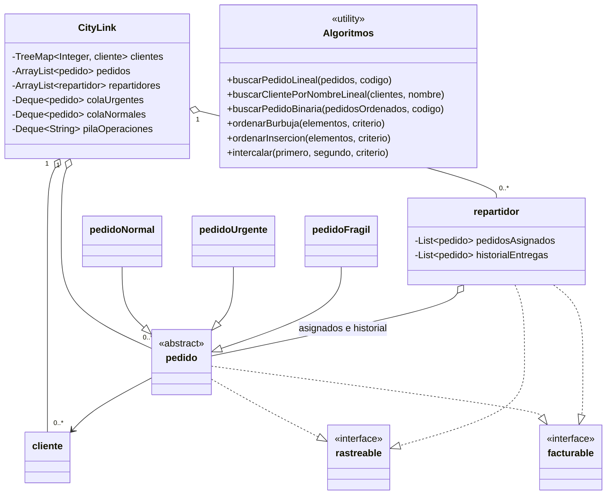

# CityLink - Programacion I

## Alcance

Este avance conserva las clases, el polimorfismo y las excepciones del Entregable 1. Sustituye el almacenamiento de capacidad fija por colecciones de `java.util` e incorpora algoritmos manuales. El menu sigue siendo el del Entregable 1: por ahora no se agregaron las nuevas opciones del menu del Entregable 2.

## Estructuras y algoritmos

- `CityLink` guarda clientes en `TreeMap<Integer, cliente>` (ordenados por codigo), pedidos y repartidores en `ArrayList`, pendientes urgentes y normales en dos `ArrayDeque` y registra operaciones en una pila `ArrayDeque`.
- `repartidor` mantiene con listas los pedidos asignados y el historial de entregas.
- `algoritmos.Algoritmos` contiene busqueda lineal, busqueda binaria, ordenamiento burbuja, ordenamiento por insercion e intercalacion. Los ordenamientos e intercalacion reciben un `Comparator` y no usan `Collections.sort`, `List.sort` ni `binarySearch`.
- La busqueda binaria de `CityLink` prepara una copia ordenada por codigo antes de buscar. La busqueda binaria de `Algoritmos` recibe una lista que ya debe estar ordenada por codigo.
- Las busquedas de algoritmo devuelven `null` si no encuentran el elemento. Las busquedas de clientes de `CityLink` informan la ausencia con `ClienteNoEncontradoException`.

Ejemplos de criterios para ordenar pedidos:

```java
Comparator<pedido> porDistancia =
        Comparator.comparingDouble(p -> p.getDistanciaKm());
Comparator<pedido> porFecha =
        Comparator.comparing(p -> p.getFechaHora());
Comparator<pedido> porCosto =
        Comparator.comparingDouble(p -> p.calcularImporte());

List<pedido> ordenados = Algoritmos.ordenarInsercion(cityLink.getPedidos(), porFecha);
```

Para ordenar por costo, los pedidos deben tener un vehiculo asignado, ya que el importe depende de su tarifa.

## Diagrama de clases



## Compilar y ejecutar

Requiere un JDK instalado. Desde PowerShell, en la carpeta `trabajo`:

```powershell
New-Item -ItemType Directory -Force out | Out-Null
$sources = Get-ChildItem -Recurse -File src -Filter *.java | ForEach-Object { $_.FullName }
javac -encoding UTF-8 -d out $sources
java -cp out app.Main
```

## Casos de prueba documentados

Se pueden probar estos casos usando `Algoritmos` y `CityLink`:

| Caso | Entrada/accion | Resultado esperado |
|---|---|---|
| Lista con varios pedidos | Busqueda lineal por un codigo existente | Devuelve el pedido con ese codigo |
| Lista ordenada por codigo | Busqueda binaria de un pedido existente | Devuelve el pedido con ese codigo |
| Elemento inexistente | Busqueda lineal o binaria por un codigo ausente | Devuelve `null`; `CityLink.buscarCliente(codigo)` lanza `ClienteNoEncontradoException` |
| Lista vacia | Buscar en una lista vacia | Busquedas devuelven `null`; ordenamientos e intercalacion devuelven una lista vacia |
| Un elemento | Ordenar o buscar el unico elemento | El elemento se conserva y se encuentra |
| Intercalacion | Intercalar dos listas ordenadas | Resultado ordenado, sin volver a ordenar las listas de entrada |
| Ordenamiento | Aplicar burbuja e insercion con el mismo `Comparator` | Ambos resultados quedan ordenados y las listas originales no cambian |
| Clientes | Registrar codigos fuera de orden y recorrer `getClientes()` | Los clientes se listan por codigo ascendente |
| Colas | Registrar pedidos urgentes y normales | Cada cola conserva el orden de llegada de sus pedidos |

La busqueda binaria exige entrada ordenada por codigo. En caso de querer probar una lista vacia o de un solo elemento, se puede pasar `List.of()` o `List.of(pedido)` a los metodos de `Algoritmos`.

## Declaracion de uso de IA

Se uso Copilot en VS Code como asistente para orientar la migracion a colecciones dinamicas, la implementacion de los algoritmos y la actualizacion de esta documentacion. El resultado se verifico compilando todos los archivos Java con `javac` y comprobando los casos de busqueda, ordenamiento e intercalacion indicados arriba. No se usaron funciones de ordenamiento ni busqueda binaria de `java.util`.
